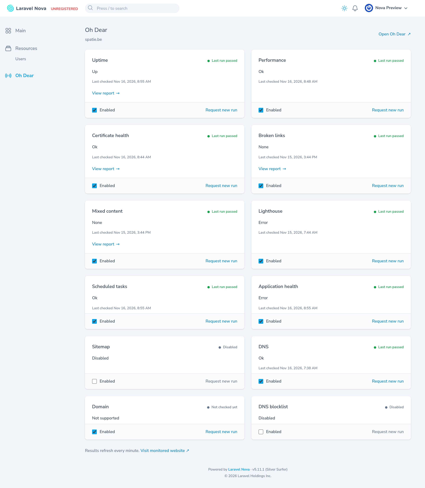

# Display Oh Dear checks in Laravel Nova

[](https://packagist.org/packages/ohdearapp/nova-ohdear-tool)
[](https://github.com/ohdearapp/nova-ohdear-tool/actions/workflows/tests.yml)
[](https://packagist.org/packages/ohdearapp/nova-ohdear-tool)

View your [Oh Dear](https://ohdear.app) monitor's checks without leaving Nova. Enable or disable checks, request new runs, and open reports for uptime, broken links, mixed content, and certificate health. The overview refreshes every minute while the tab is visible.

The tool uses Nova's Inertia navigation and supports its light and dark themes.

Application-health reports show individual results, messages, update times, and per-check status history. Scheduled-task reports show every monitored task, its schedule and timezone, latest heartbeat result, last ping, and grace period. Both reports indicate existing snoozes without changing them. Heartbeat URLs and arbitrary health-check metadata are not sent to the browser.



## Requirements

- PHP 8.4 or later
- Laravel 13
- Laravel Nova 5.11.1 or later in the 5.x series, with a valid license
- An Oh Dear API token with access to the monitor

Version 2 does not support older PHP, Laravel, or Nova versions. See [UPGRADING.md](UPGRADING.md) when upgrading from version 1.

## Installation

First [install Nova](https://nova.laravel.com/docs/v5/installation). Your application needs the `https://nova.laravel.com` Composer repository and Nova authentication configured.

```sh
composer require ohdearapp/nova-ohdear-tool:^2.0
```

Register the tool in your application's `NovaServiceProvider`:

```php
use OhDear\OhDearTool\OhDearTool;

public function tools(): array
{
    return [
        new OhDearTool,
    ];
}
```

Add these values to your application's environment. Create a token in your [Oh Dear account](https://ohdear.app/docs/api/authentication) and copy the monitor ID from Oh Dear.

```dotenv
OH_DEAR_API_TOKEN=your-api-token
OH_DEAR_MONITOR_ID=your-monitor-id
```

The package loads its configuration automatically. To customize it, publish the config file:

```sh
php artisan vendor:publish --tag=nova-ohdear-tool-config
```

One configured monitor is shown to users who can access the tool. To restrict access, use Nova's `canSee` callback:

```php
(new OhDearTool)->canSee(fn ($request) => $request->user()->is_admin)
```

The same authorization protects the tool's pages and API. Users with access can change the configured monitor's checks. Reports for other check types remain available in Oh Dear.

## Development

Tests use Pest 5 and Orchestra Testbench. Authenticate Composer with your Nova account email and license key before installing dependencies. Never commit `auth.json` or a license key.

```sh
composer install
composer test
composer analyse
composer format:test
npm ci
npm run format:check
npm run build
```

Commit rebuilt files in `dist` whenever frontend code changes. Nova provides Vue at runtime; the tool does not bundle a second Vue instance. Node.js 22.12 or later is required to build assets.

GitHub Actions tests PHP 8.4, 8.5, and 8.6 against Laravel 13, including lowest dependencies on PHP 8.4. Pest 5 requires Symfony Process 8, which is incompatible with the Testbench version for Laravel 12.

The PHP 8.6 job is a forward-compatibility check: Nova's OpenSpout dependency currently permits PHP only through 8.5. That job ignores PHP upper bounds during dependency installation, but still runs tests, static analysis, formatting, and the security audit on PHP 8.6. PHP 8.4 and 8.5 enforce all platform requirements.

Configure the repository's Actions secrets `NOVA_USERNAME` (Nova account email) and `NOVA_LICENSE_KEY` for licensed dependency installation. Forked pull requests cannot access these secrets; maintainers must review contributions before running them on a trusted branch. Do not expose the secrets through `pull_request_target`.

## Credits

- [Freek Van der Herten](https://github.com/freekmurze)
- [Bram](https://github.com/bram-pkg), for reporting the Nova compatibility gap in [#53](https://github.com/ohdearapp/nova-ohdear-tool/issues/53)
- [Dependabot](https://github.com/apps/dependabot), for the dependency security updates in [#56](https://github.com/ohdearapp/nova-ohdear-tool/pull/56) and [#57](https://github.com/ohdearapp/nova-ohdear-tool/pull/57), superseded by the Vite build
- [All Contributors](../../contributors)

## License

The MIT License (MIT). Please see [License File](LICENSE.md) for more information.
